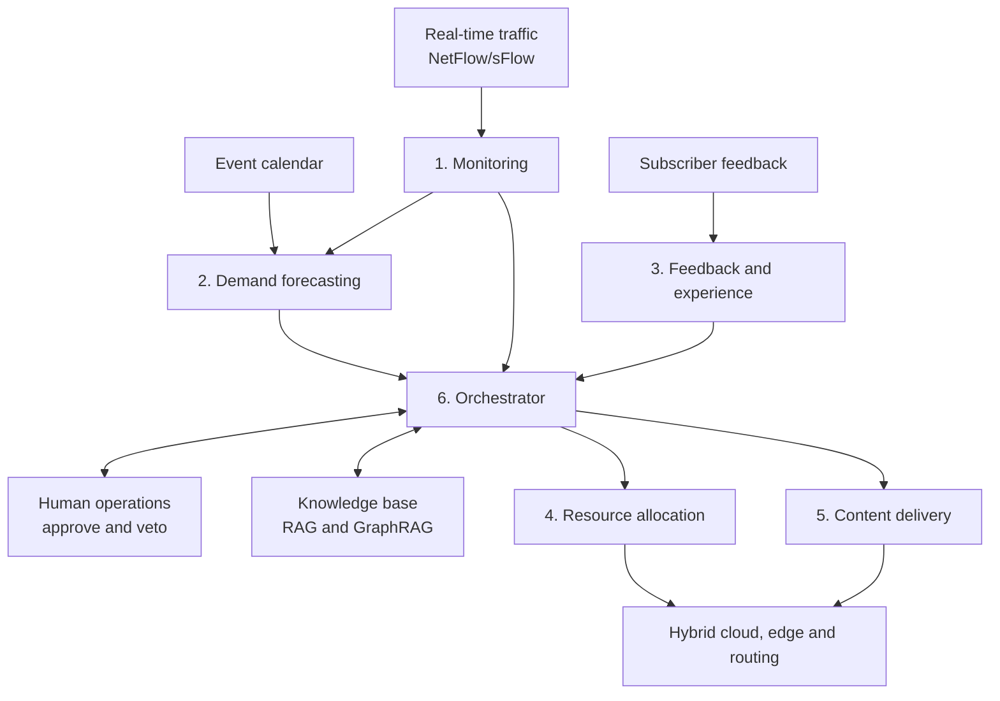

# A streaming network with AI agents

Architecture of a multi-agent system that predicts demand peaks on a video streaming network, prepares capacity ahead of them and adjusts delivery during them.

Final project of the postgraduate program in Cognitive Systems with AI Agents (Data Science Academy, Brazil), November 2026. [Versão em português](README.md)

> **What this repository is:** an architecture design, with the decisions and the reasoning behind them. There is no running code and no real data; the scenario is the exercise proposed by the program. See [Limits](#limits).

- **Full document (in Portuguese):** [docs/solucao-completa.md](docs/solucao-completa.md) ([PDF](docs/solucao-completa.pdf))
- **Case study:** [garofalodeveloper.com/en/cases/rede-streaming.html](https://garofalodeveloper.com/en/cases/rede-streaming.html)

## The problem

A streaming company stalls at its moments of highest audience (live events, launches) because it only reacts to congestion after it shows up. The request: AI agents to predict peaks, allocate network resources dynamically and adjust delivery according to network conditions and user feedback. The company already has NetFlow/sFlow monitoring, BigQuery, Splunk, Apache Spark and a hybrid cloud.

I reduced it to two business questions:

1. How much demand will we have, where and when?
2. Given that demand and the state of the network, what is the best action right now to keep video smooth at the lowest cost?

## The solution

| Agent | What it does | How it decides |
|---|---|---|
| 1. Monitoring | Keeps the current state of each region and detects traffic outside the forecast | Stream aggregation (Spark) and statistical anomaly detection |
| 2. Demand forecasting | Forecasts traffic by region, content type and device | Predictive model with quantile forecasts |
| 3. Feedback and experience | Turns ratings into a structured signal | Small language model, fine-tuned |
| 4. Resource allocation | Decides where to scale capacity and where to steer traffic | Cost-constrained optimization |
| 5. Content delivery | Adjusts quality by region and device | Bounded policies |
| 6. Orchestrator | Coordinates, applies guardrails, calls people and explains | LLM on a state graph (LangGraph), with human approval |

### Each decision on the right clock

| Layer | Clock | Who decides |
|---|---|---|
| Data plane | milliseconds to seconds | Existing deterministic mechanisms, no agents |
| Tactical control | seconds to minutes | Agents with predictive models and optimization, within limits |
| Strategic control | minutes to days | Agents with an LLM: plan, interpret, coordinate, explain |

## Decisions and discarded alternatives

| Decision | Reasoning | Discarded alternative |
|---|---|---|
| Agents, not just a model | The problem calls for a continuous loop of sensing, deciding and acting | A forecasting model on a dashboard |
| Six agents with a supervisor | Distinct responsibilities and clocks, isolated failure, audit in one place | A single agent; agents negotiating freely |
| LLM only in the strategic layer | Latency, cost and variability do not fit real-time network decisions | LLM deciding allocation directly |
| Quantile forecasts | The cost of error is asymmetric: too little capacity costs more than too much | Point forecast by the mean |
| Gradient boosting with a statistical baseline | Strong on tabular data, explainable, cheap to operate | Starting with deep learning |
| Optimization before reinforcement learning | Respects constraints and is auditable; RL only in a simulator | RL learning in production |
| LangGraph | Explicit flow, persisted state, human approval, traceable | CrewAI (less control over the flow) |
| RAG and GraphRAG for knowledge | Company knowledge keeps changing; a network is a graph | Fine-tuning to teach facts; vector search only |
| Small fine-tuned model for feedback | Repetitive task, high volume, data stays in-house | A large LLM over an API for classification |
| Delivery adjustment by device | Degrades where nobody notices, instead of stalling | Only adding capacity |
| Reuse BigQuery, Spark and Splunk | Lower cost and risk, faster adoption | A brand-new platform |
| Progressive autonomy | Trust is built on evidence | Full automation from day one |
| Require event calendar and player telemetry | They are the real cause and effect of the peaks, missing from the listed data | Working only with the given sources |

## What the full document covers

1. Problem understanding, success metrics and delivery format
2. Gaps in the brief and the assumptions adopted, with the effect of each being wrong
3. The data, source by source: type, arrival, quality issues and use
4. Overview and the three time layers
5. The six agents, communication and tools
6. Knowledge base: RAG, GraphRAG and Agentic RAG
7. Forecasting and language models and techniques
8. Infrastructure, deployment and continuous operations
9. Two operating scenarios: expected peak and unexpected peak
10. Guardrails, explainability, observability and monitoring
11. How to prove it works
12. Rollout in five phases
13. Risks and mitigation
14. Summary of decisions

## Limits

- **It is an architecture design.** No decision was validated on a real network.
- **Timeline and team are estimates**, with no reference from the scenario.
- **There are no improvement figures.** Without the company's baseline, any percentage would be made up. The document says how to measure.
- **The scenario belongs to Data Science Academy.** The company in the exercise is fictional and the original brief is not reproduced here; the analysis, the architecture and the text are mine.

## Author

Thiago Garofalo · [garofalodeveloper.com](https://garofalodeveloper.com/en/) · [LinkedIn](https://www.linkedin.com/in/thiago-garofalo-792a2653/)

## License

Text and diagrams under [CC BY 4.0](https://creativecommons.org/licenses/by/4.0/). Use and adapt freely, with attribution.
