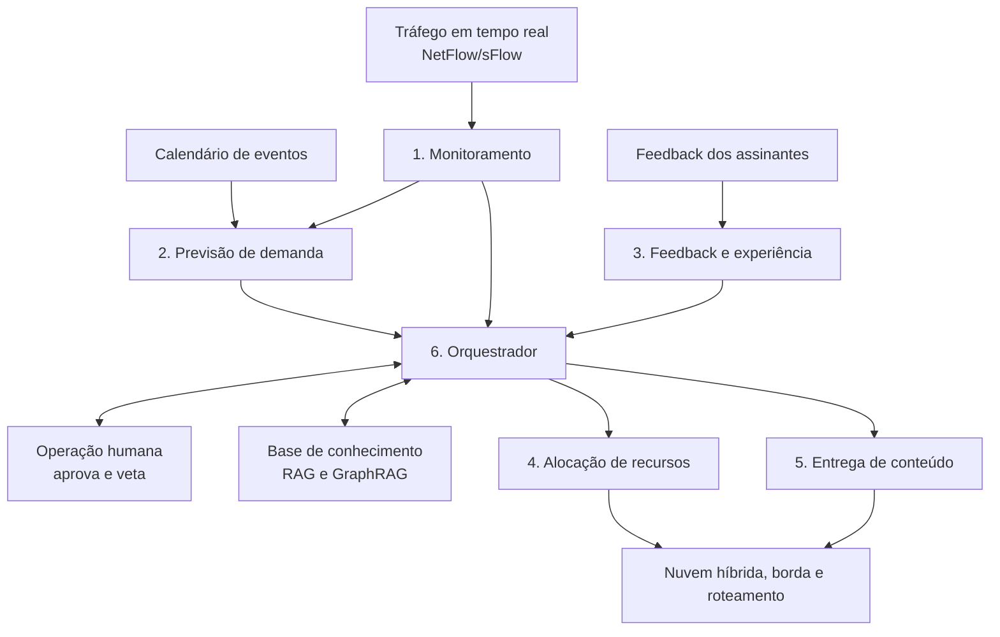

# Rede de streaming com agentes de IA

Arquitetura de um sistema multiagente que prevê picos de demanda numa rede de streaming de vídeo, prepara a capacidade antes deles e ajusta a entrega durante eles.

Projeto final da pós-graduação em Sistemas Cognitivos com Agentes de IA (Data Science Academy), novembro de 2026. [English version](README.en.md)

> **O que este repositório é:** um projeto de arquitetura, com as decisões e as justificativas. Não há código rodando nem dados reais; o cenário é o exercício proposto pela pós. Veja [Limites](#limites).

- **Documento completo:** [docs/solucao-completa.md](docs/solucao-completa.md) ([PDF](docs/solucao-completa.pdf))
- **Case no portfólio:** [garofalodeveloper.com/cases/rede-streaming.html](https://garofalodeveloper.com/cases/rede-streaming.html)

## O problema

Uma empresa de streaming trava nos momentos de maior audiência (eventos ao vivo, lançamentos) porque só reage ao congestionamento depois que ele aparece. O pedido: agentes de IA para prever picos, alocar recursos de rede dinamicamente e ajustar a entrega conforme a rede e o retorno dos usuários. A empresa já tem monitoramento com NetFlow/sFlow, BigQuery, Splunk, Apache Spark e nuvem híbrida.

Reduzi a duas perguntas de negócio:

1. Quanta demanda teremos, onde e quando?
2. Dada essa demanda e o estado da rede, qual é a melhor ação agora para manter o vídeo fluido ao menor custo?

## A solução

| Agente | O que faz | Como decide |
|---|---|---|
| 1. Monitoramento | Mantém o estado atual de cada região e detecta tráfego fora do previsto | Agregação em fluxo (Spark) e detecção estatística de anomalia |
| 2. Previsão de demanda | Prevê o tráfego por região, tipo de conteúdo e dispositivo | Modelo preditivo com previsão por quantis |
| 3. Feedback e experiência | Transforma avaliações em sinal estruturado | Modelo de linguagem pequeno, com ajuste fino |
| 4. Alocação de recursos | Decide onde escalar capacidade e para onde redirecionar tráfego | Otimização com restrições de custo |
| 5. Entrega de conteúdo | Ajusta a qualidade por região e dispositivo | Políticas com limites |
| 6. Orquestrador | Coordena, aplica travas, aciona pessoas e explica | LLM em grafo de estados (LangGraph), com aprovação humana |

### Cada decisão no relógio certo

| Camada | Relógio | Quem decide |
|---|---|---|
| Plano de dados | milissegundos a segundos | Mecanismos determinísticos já existentes, sem agentes |
| Controle tático | segundos a minutos | Agentes com modelos preditivos e otimização, dentro de limites |
| Controle estratégico | minutos a dias | Agentes com LLM: planejar, interpretar, coordenar, explicar |

## Decisões e alternativas descartadas

| Decisão | Justificativa | Alternativa descartada |
|---|---|---|
| Agentes, não só um modelo | O problema pede ciclo contínuo de perceber, decidir e agir | Modelo de previsão em um painel |
| Seis agentes com supervisor | Responsabilidades e relógios distintos, falha isolada, auditoria em um ponto | Agente único; agentes negociando livremente |
| LLM só na camada estratégica | Latência, custo e variabilidade não cabem em decisão de rede em tempo real | LLM decidindo alocação direto |
| Previsão por quantis | O custo do erro é assimétrico: faltar capacidade custa mais do que sobrar | Previsão pontual pela média |
| Gradient boosting com linha de base estatística | Forte em dado tabular, explicável, barato de operar | Começar por deep learning |
| Otimização antes de aprendizado por reforço | Respeita restrições e é auditável; reforço só em simulador | Reforço aprendendo em produção |
| LangGraph | Fluxo explícito, estado persistido, aprovação humana, rastreável | CrewAI (menos controle do fluxo) |
| RAG e GraphRAG para conhecimento | O conhecimento da empresa muda sempre; rede é um grafo | Ajuste fino para ensinar fatos; só busca vetorial |
| Modelo pequeno com ajuste fino para o feedback | Tarefa repetitiva, volume alto, dado fica na empresa | LLM grande por API para classificar |
| Ajuste de entrega por dispositivo | Degrada onde não se percebe, em vez de travar | Só adicionar capacidade |
| Reaproveitar BigQuery, Spark e Splunk | Menor custo e risco, adoção rápida | Plataforma totalmente nova |
| Autonomia progressiva | Confiança se constrói com evidência | Automação total desde o início |
| Pedir calendário de eventos e telemetria do player | São a causa e o efeito reais dos picos, ausentes nos dados listados | Trabalhar só com as fontes dadas |

## O que está no documento completo

1. Entendimento do problema, métricas de sucesso e forma de entrega
2. Lacunas do enunciado e premissas adotadas, com o efeito de cada uma estar errada
3. Os dados, fonte a fonte: tipo, chegada, problemas de qualidade e uso
4. Visão geral e as três camadas de tempo
5. Os seis agentes, comunicação e ferramentas
6. Base de conhecimento: RAG, GraphRAG e Agentic RAG
7. Modelos e técnicas de previsão e de linguagem
8. Infraestrutura, deploy e operação contínua
9. Dois cenários de funcionamento: pico previsto e pico inesperado
10. Guardrails, explicabilidade, observabilidade e monitoramento
11. Como provar que funciona
12. Implantação em cinco fases
13. Riscos e mitigação
14. Resumo das decisões

## Limites

- **É um projeto de arquitetura.** Nenhuma decisão foi validada em uma rede de verdade.
- **Prazo e equipe são estimativas**, sem referência do cenário.
- **Não há números de ganho.** Sem a linha de base da empresa, qualquer percentual seria inventado. O documento diz como medir.
- **O cenário é da Data Science Academy.** A empresa do exercício é fictícia e o enunciado original não está reproduzido aqui; a análise, a arquitetura e o texto são meus.

## Autor

Thiago Garofalo · [garofalodeveloper.com](https://garofalodeveloper.com) · [LinkedIn](https://www.linkedin.com/in/thiago-garofalo-792a2653/)

## Licença

Texto e diagramas sob [CC BY 4.0](https://creativecommons.org/licenses/by/4.0/deed.pt-br). Pode usar e adaptar, citando a fonte.
